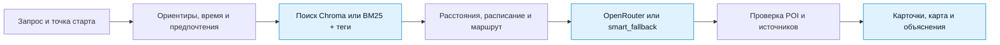

<div align="center">

<picture>
  <source media="(prefers-color-scheme: dark)" srcset="docs/img/logo-dark.svg">
  <source media="(prefers-color-scheme: light)" srcset="design.svg">
  
</picture>

# Astana Walk AI

**Куда сходить рядом — с учётом времени, погоды и ваших планов.**

RAG-помощник по прогулкам в Астане: реальные места, короткие маршруты и понятные источники.

<p>
  
  
  
  
  
  
</p>

[Скриншоты](#screenshots) · [Возможности](#features) · [Быстрый старт](#quickstart) · [Docker](#docker) · [Как работает](#architecture) · [API](#api) · [Документация](#docs) · [Участие](#contributing)

**975 мест** &nbsp; / &nbsp; **21 категория** &nbsp; / &nbsp; **Мультиязычные ответы** &nbsp; / &nbsp; **6 готовых сценариев**

<sub>Build with AI · Школа ИИ и науки о данных · Трек 1 · НИЦ Smart City и GDG Astana</sub>

</div>

---

> «Я возле Mega Silk Way, у меня 30–60 минут. Куда пойти?»

Astana Walk подбирает **1–3 места поблизости**, объясняет выбор, оценивает время пешком и на посещение. Если данных достаточно, собирает маршрут из нескольких точек. В ответе видно, откуда взяты факты, что предложила модель и насколько можно доверять расписанию.

<a id="screenshots"></a>
## Скриншоты

<p align="center">
  
  <br>
  <sub>Рекомендации в чате: почему стоит пойти, сколько идти и какие сведения подтверждены данными.</sub>
</p>

<p align="center">
  
  <br>
  <sub>Точки на карте, зона локации ~100 м и легенда статусов работы.</sub>
</p>

<p align="center">
  
  <br>
  <sub>Переходы между остановками, время на месте и общий бюджет прогулки.</sub>
</p>

<a id="features"></a>
## Возможности

| | Что умеет Astana Walk |
| :--- | :--- |
| **Места с источниками** | 966 POI из OpenStreetMap и 9 мест с официального портала Visit Astana. Ответы проверяются по кандидатам поиска. |
| **Поиск по смыслу и словам** | Chroma с мультиязычными эмбеддингами или BM25 с тегами. Без векторного индекса доступен поиск по всему датасету. |
| **Контекст прогулки** | Ориентиры в тексте, бюджет времени, выбранная погода, размер компании и доступность без ступенек. |
| **Расписание с оговорками** | Проверка времени прихода и окна визита в часовом поясе Астаны. Если расписания нет, статус — `unknown`. |
| **Короткие маршруты** | Связанная цепочка из 2–3 мест с оценкой переходов и общей длительности. |
| **Чат, карта и голос** | История запросов, карта PyDeck, геолокация по разрешению браузера и голосовой ввод. Настройки открываются шестерёнкой. |
| **Язык вашего сообщения** | Ответы автоматически следуют языку запроса. Для языков кроме русского и казахского названия мест показываются по-английски; название из источника доступно в деталях карточки. |
| **Прозрачный RAG** | Инспектор показывает распознанный контекст, кандидатов поиска и сообщения для модели. Факты и идеи отмечены отдельно. |
| **Работа без LLM** | При отсутствии ключа или ошибке вызова модели используется шаблонная генерация `smart_fallback`. |

### Попробуйте спросить

- «Тихое место с кофе и розеткой на час».
- «Куда сходить с ребёнком, если на улице холодно?»
- «Я у Экспо 2017. Хочу что-нибудь необычное на 1–2 часа».
- “Where can I eat nearby?” или «附近有什么值得参观的地方？».

### Язык интерфейса и ответов

Кнопка **RU / KZ / EN** под логотипом открывает выбор языка **интерфейса**: нового чата, настроек и навигации. Язык каждого ответа определяется по сообщению отдельно; переключение интерфейса не переводит историю заново.

Nemotron через OpenRouter пишет объяснения и планы на русском, казахском или английском. Для других распознанных языков он переводит запрос для поиска и оформляет найденные места на языке пользователя, включая подписи расстояний и времени. Обычно нужны два последовательных вызова; простые китайские вопросы вроде «附近有什么？» обходятся одним. Фиксированные китайские подписи хранятся локально, остальные переводы подписей переиспользуются между ответами. Повторное открытие ответа не вызывает модель заново. Поиск, идентификаторы мест, расстояния, время и статусы работы проверяются кодом.

Для дополнительных языков нужен ключ OpenRouter. Если перевод недоступен, приложение явно предупреждает и показывает резервный ответ на английском с кнопкой «Повторить перевод». Перевод запрашивается в JSON-режиме, без рассуждений и скрытых повторов SDK. Без LLM поддерживаются шаблонные ответы RU / KZ / EN. Для коротких неоднозначных сообщений язык определяется менее надёжно. Английское название в карточке может быть переводом или транслитерацией, а не официальным названием места.

Для обычных запросов «кофе / поесть рядом» текстовый и голосовой режимы предпочитают
близкие места: сначала проверяются 300 м, затем радиус расширяется при отсутствии
подходящих вариантов, в пределах настройки пользователя. Конкретные названия,
особые требования и маршруты с бюджетом времени сохраняют ранжирование по релевантности.
Если не удалось перевести сам текстовый запрос для поиска, места не подставляются
наугад: приложение предлагает повторить перевод.

<a id="quickstart"></a>
## Быстрый старт

### Локально через uv

Нужен [uv](https://docs.astral.sh/uv/getting-started/installation/). Версия Python для проекта закреплена в [`.python-version`](.python-version); `uv` создаст окружение `.venv`.

```bash
git clone https://github.com/01danl/AI-for-smart-city-Hackathon.git
cd AI-for-smart-city-Hackathon
uv sync --locked
cp -n .env.example .env
uv run --locked streamlit run frontend/app.py --server.address 127.0.0.1 --server.port 8501
```

Откройте **[127.0.0.1:8501](http://127.0.0.1:8501)**. Можно сразу выбрать один из шести сценариев слева или написать свой запрос. Готовый датасет уже в репозитории; для первого запуска не нужно собирать индекс Chroma.

> [!TIP]
> **Сначала попробуйте без ключа.** Поиск, карточки, карта и шаблонные объяснения работают без OpenRouter. Для ответов модели добавьте ключ в `.env` и перезапустите приложение.

<a id="docker"></a>
### Через Docker Compose

Нужен запущенный Docker Desktop или Docker Engine с Compose **2.24+**. Устанавливать Python и uv на компьютер не требуется.

```bash
cp -n .env.example .env
# При необходимости добавьте OPENROUTER_API_KEY и GEMINI_API_KEY в .env.
docker compose up --build -d --wait
```

**[Интерфейс → localhost:8501](http://localhost:8501)** · **[API → localhost:8000/docs](http://localhost:8000/docs)**

Один образ запускает два независимых сервиса: Streamlit и FastAPI. Зависимости устанавливаются через uv из `uv.lock`, в образ уже включены датасет, карта и голосовой интерфейс. По умолчанию используется BM25; отзывы сохраняются в отдельном volume. `.env` исключён из контекста сборки, ключи передаются только при запуске.

```bash
docker compose ps           # состояние и healthcheck
docker compose logs -f     # логи обоих сервисов
docker compose down        # остановить, сохранив отзывы
```

Микрофон и геолокация работают через `localhost` с разрешения браузера. Для удалённого доступа нужен HTTPS. Порты, обновление ключей, сохранение данных и опциональная Chroma описаны в **[инструкции Docker](docs/docker.md)**.

### Подключение OpenRouter

```env
OPENROUTER_API_KEY=ваш_ключ
OPENROUTER_BASE_URL=https://openrouter.ai/api/v1
OPENROUTER_MODEL=nvidia/nemotron-3-ultra-550b-a55b:free
RETRIEVAL_BACKEND=auto
```

Модель задаётся конфигурацией. Указанный идентификатор — настройка проекта из [`.env.example`](.env.example); доступность и лимиты определяет провайдер. Ключи хранятся в локальном `.env`, который исключён из Git.

<details>
<summary><b>Конфигурация поиска и голосового ввода</b></summary>

| Переменная | Назначение |
| :--- | :--- |
| `RETRIEVAL_BACKEND` | `auto`: готовый индекс Chroma → BM25 по датасету → тестовый `stub`. Доступен явный выбор `chroma`, `bm25`, `stub`. |
| `POI_DATA_PATH` | Путь к местам; по умолчанию `data/poi.json`. |
| `CHROMA_DIR` | Каталог индекса; по умолчанию `data/chroma`. |
| `EMBEDDING_MODEL` | Локальная модель эмбеддингов для векторного поиска. |
| `OPENROUTER_VOICE_MODEL` | Модель серверного распознавания речи; значение проекта — в `.env.example`. |

Микрофон в поле ввода записывает короткое сообщение и отправляет его в OpenRouter STT для распознавания. Это диктовка; для текстового ввода микрофон не нужен.

</details>

### Живой голосовой разговор · Gemini Live

Включите **«Голосовой разговор»** над полем ввода и нажмите **«Начать разговор»**.
Ассистент отвечает вслух на языке вашей речи, помнит контекст текущего звонка
и допускает перебивания: «Где выпить кофе?» → «А поближе?».
Реплики появляются по мере речи в **основном чате**. После поиска под ответом появляются
обычные карточки мест; справа карта подстраивается под новые точки и показывает маршрут.
Карточки остаются на языке интерфейса. Диалог сохраняется в истории текущей сессии,
его можно открыть после завершения звонка.
Можно выключить микрофон или завершить разговор. Переход в другой чат завершает сессию.

Добавьте отдельный ключ из [Google AI Studio](https://aistudio.google.com/apikey) в локальный `.env`:

```dotenv
GEMINI_API_KEY=ваш_ключ
GEMINI_LIVE_MODEL=gemini-3.8-live
```

Запуск прежний: `uv run --locked streamlit run frontend/app.py`. Дополнительный сервер
и npm не нужны. Микрофон работает на localhost или HTTPS, с разрешения браузера.
Используйте актуальный Chrome/Safari; наушники уменьшают эхо.
Без ключа текстовый чат и прежняя диктовка продолжают работать.

Звук идёт напрямую в Gemini через WebSocket. Основной ключ остаётся на сервере;
браузер получает одноразовый токен на 10 минут, ограниченный моделью и инструментом поиска.
Поиск использует существующий RAG без второго вызова Nemotron. Голосовая модель получает
только найденные POI, расстояния и статусы, без координат пользователя или мест.
Настройки точки старта и фильтров фиксируются при подключении; после их изменения
начните новый разговор. Аудио не пишется на диск; расшифровка и результаты поиска
хранятся в памяти текущей Streamlit-сессии, как сообщения текстового чата.

В [тарифах Gemini](https://ai.google.dev/gemini-api/docs/pricing) для Live указан Free Tier;
доступность модели и квоту проверяйте в своём проекте. Подписка Gemini Pro и биллинг API
[учитываются отдельно](https://ai.google.dev/gemini-api/docs/google-ai-plans).
На Free Tier Google может использовать переданные данные для улучшения продуктов.
Подробности архитектуры и проверки — в [docs/live_voice.md](docs/live_voice.md).

<details>
<summary><b>Опционально: векторный поиск Chroma</b></summary>

```bash
uv sync --locked --extra vector
uv run --locked --extra vector python scripts/build_index.py
uv run --locked --extra vector streamlit run frontend/app.py --server.port 8501
```

Первый запуск сборки скачивает модель `sentence-transformers/paraphrase-multilingual-MiniLM-L12-v2`. Индекс создаётся в `data/chroma/`. При работе с ним сохраняйте `--extra vector` в командах `uv run`.

</details>

<a id="architecture"></a>
## Как работает



**Поиск выбирает места, модель объясняет выбор.** Идентификаторы POI проверяются по базе и кандидатам поиска. Расстояния и статусы работы рассчитываются кодом. Сырые координаты пользователя не добавляются в промпт рекомендаций.

| Слой | Код |
| :--- | :--- |
| Намерения, география, расписание и поиск | [`backend/retrieval/`](backend/retrieval/) |
| Генерация, промпты и проверка ответа | [`backend/generation/`](backend/generation/) |
| HTTP API | [`backend/api/app.py`](backend/api/app.py) |
| Интерфейс | [`frontend/app.py`](frontend/app.py) |

Подробнее: [описание RAG](docs/rag_approach.md) · [обзор репозитория](docs/repo_overview.md).

### Как читать ответ

| Метка | Значение |
| :--- | :--- |
| `poi_data` | Информация из базы мест. |
| `generated_idea` | Предложенный ИИ план занятия; факты о месте берутся из базы. |
| `confirmed_open` | Открыто по расписанию в базе. |
| `likely_open` | Открыто на момент проверки, но есть ограничение по окну визита. |
| `unknown` | Данных о часах работы недостаточно. |
| `likely_closed` | По расписанию место закрыто. |

<a id="api"></a>
## REST API

Во втором терминале, из корня проекта:

```bash
uv run --locked uvicorn backend.api.app:app --host 127.0.0.1 --port 8000
```

Интерактивная документация: **[127.0.0.1:8000/docs](http://127.0.0.1:8000/docs)**.

| Метод | Путь | Назначение |
| :--- | :--- | :--- |
| `POST` | `/recommend` | Рекомендации с контекстом, источниками и маршрутом. |
| `GET` | `/health` | Статус сервиса, режим поиска и конфигурация LLM. |
| `GET` | `/presets` | Шесть готовых сценариев для демо. |
| `GET` | `/pois/stats` | Число мест, категории и заполненность расписаний. |

<details>
<summary><b>Пример запроса</b></summary>

```bash
curl http://127.0.0.1:8000/recommend \
  -H "Content-Type: application/json" \
  -d '{
    "query": "Я возле Mega Silk Way, хочу прогуляться 30–60 минут",
    "lat": 51.0891,
    "lon": 71.4073,
    "max_distance_m": 2500,
    "lang": "ru",
    "include_route": true
  }'
```

В ответе: `used_data` — использованный контекст; `recommendations` — карточки мест; `route` — маршрут, если удалось его собрать; `disclaimer` — оговорки. Описание полей — в [словаре данных](docs/data_dictionary.md).

</details>

## Данные и ограничения

Текущий срез [`data/poi.json`](data/poi.json): **975 мест**, **21 категория**, расписания заполнены у **338 мест** (34,7%). Данные OSM собраны 16.10.2026; происхождение дополнительных мест описано отдельно.

| Источник | Мест | Воспроизводимость |
| :--- | ---: | :--- |
| OpenStreetMap | 966 | [Сборщик Overpass](scripts/collect_osm.py) |
| Официальный портал Visit Astana | 9 | [Сбор и проверка](docs/official_data_collection.md) · [подтверждения полей](data/poi_sources.json) |

Расписания могут устаревать. Время пешком — оценка по расстоянию с поправочным коэффициентом, без полноценного пешеходного графа. Погода задаётся пользователем; живой погодный API пока не подключён.

<details>
<summary><b>Обновление датасета</b></summary>

```bash
# Новый срез OpenStreetMap
uv run --locked python scripts/collect_osm.py

# Проверка официальных карточек Visit Astana
uv run --locked python scripts/collect_official_poi.py --download
uv run --locked python scripts/collect_official_poi.py

# Применение проверенного списка
uv run --locked python scripts/collect_official_poi.py --apply
```

После обновления проверьте изменения `data/poi.json` и источники. Если используете Chroma, пересоберите индекс.

</details>

### Приватность

- В интерфейсе и логах координаты округляются до трёх знаков после запятой — примерно до 100 м. Это снижение точности, а не гарантия анонимности.
- Сырые координаты не включаются в промпт рекомендаций. Модель получает кандидатов и рассчитанные расстояния.
- Геолокация и микрофон включаются с разрешения браузера. Распознавание речи может обрабатываться внешним сервисом.
- Отсутствующие часы работы и неполные сведения показываются явно.

Подробнее: [этика и приватность](docs/ethics_privacy.md).

## Проверки

```bash
uv run --locked python -m pytest tests -q
```

Набор включает **11 сценариев S1–S11**: работа с ноутбуком, прогулка, культура, семейный ужин, поздний вечер, доступность, английский язык, пустая выдача, бессмысленный запрос, туризм и спорт. Дополнительно проверяются API, маршруты, источники, приватность промпта и переходы между чатами.

[Тестовые сценарии](docs/test_scenarios.md) · [Примеры поиска](docs/retrieval_examples.md) · [Автотесты](tests/).

<a id="docs"></a>
## Документация и материалы для жюри

| № | Артефакт | Где посмотреть |
| :---: | :--- | :--- |
| 1 | Концепция: идея, аудитория, сценарии и развитие | [Концепция продукта](docs/concept.md) |
| 2 | Демо и прототип | [Streamlit UI](frontend/app.py) · [FastAPI](backend/api/app.py) |
| 3 | Описание RAG | [Подход и архитектура](docs/rag_approach.md) |
| 4 | Сценарии проверки и примеры | [S1–S11](docs/test_scenarios.md) · [Примеры выдачи](docs/retrieval_examples.md) |
| 5 | Презентация на 5–7 минут | Отдельный артефакт сдачи: `Astana_Walk_AI_Presentation.pptx` / `.pdf` |
| 6 | Этика, приватность и ограничения данных | [Этика](docs/ethics_privacy.md) · [Словарь данных](docs/data_dictionary.md) |

## Дальше

- [ ] Афиша событий из проверяемых источников.
- [ ] Погода в реальном времени.
- [ ] Пешеходный граф и учёт тёплых переходов.
- [ ] Голосовое сопровождение маршрутов на русском, казахском и английском.

<a id="contributing"></a>
## Участие в проекте

Предложения и воспроизводимые отчёты об ошибках — в [Issues](https://github.com/01danl/AI-for-smart-city-Hackathon/issues). Для изменений создайте отдельную ветку и Pull Request; опишите результат и способ проверки.

Для новых POI укажите источник и подтверждение полей. Для интерфейса приложите скриншот. Перед PR запустите тесты и проверьте, что ключи и локальный `.env` не попали в изменения.

### Команда

| Участник | Направление |
| :--- | :--- |
| **Daniyal Bissenov** | Генерация, API и интерфейс — Роль B. |
| **Yelzhan** | Данные, поиск и маршруты — Роль A. |

---

<div align="center">
  <sub>AstanaWalk.ai · Сделано для прогулок по Астане · Build with AI</sub>
  <br>
  <sub><a href="#quickstart">Запустить локально</a> · <a href="#docs">Открыть документацию</a> · <a href="#contributing">Предложить улучшение</a></sub>
</div>
