<div align="center">

# Astana Walk AI — ИИ-помощник по прогулкам в Астане

**Hybrid Geosemantical RAG:** реальные места из OpenStreetMap + Visit Astana, честные источники, ноль выдуманных кофейен

**Хакатон:** Build with AI (Школа ИИ и науки о данных) · **Трек 1** — задача от НИЦ Smart City и GDG Astana

|  |  |  |  |  |  |  |
|:---:|:---:|:---:|:---:|:---:|:---:|:---:|

[Ключевые возможности](#-ключевые-возможности-по-критериям-жюри) · [Быстрый старт](#-быстрый-старт) · [Архитектура](#%EF%B8%8F-архитектура--как-работает-rag) · [REST API](#-rest-api) · [Тесты](#-тестовые-сценарии-s1--s11) · [Этика](#-этика-и-приватность) · [Команда](#-команда)

</div>

---

Система отвечает на запросы вида *«Я возле Mega Silk Way, у меня 30–60 минут — куда пойти?»*: находит реальные места рядом (**975 POI**), объясняет «почему», считает время пешком, предупреждает «закроется во время прогулки», строит пешую цепочку из 2–3 точек и в каждой карточке честно разделяет `[poi_data]` (факты базы) и `[generated_idea]` (идеи ИИ). Координаты пользователя никогда не сохраняются и не передаются в LLM — только округление до ~100 м.

```bash
# Проверка перед защитой: тесты + демо одной строкой
uv sync --locked && uv run python -m pytest tests -q && uv run streamlit run frontend/app.py
```

---

## 📦 Навигация по 6 обязательным артефактам для жюри

| № | Ожидаемый артефакт (по ТЗ хакатона) | Где находится в репозитории |
| :--- | :--- | :--- |
| **1** | **Концепция продукта** (идея, ЦА, сценарии, бизнес-модель, план развития) | [`docs/concept.md`](docs/concept.md) |
| **2** | **Демо / прототип** (интерактивный UI с картой, 6 пресетами жюри, микро-маршрутами и RAG-инспектором + FastAPI `/recommend`) | [`frontend/app.py`](frontend/app.py) и [`backend/api/app.py`](backend/api/app.py) |
| **3** | **Описание работы RAG-подхода** (высокоуровневая архитектура, формула ранжирования, защита от галлюцинаций) | [`docs/rag_approach.md`](docs/rag_approach.md) |
| **4** | **Набор тестовых сценариев** (11 кейсов S1–S11 + примеры выдачи + автотесты `pytest`) | [`docs/test_scenarios.md`](docs/test_scenarios.md), [`docs/retrieval_examples.md`](docs/retrieval_examples.md), [`tests/`](tests/) |
| **5** | **Краткая презентация (5–7 минут)** | В папке сдачи (`Astana_Walk_AI_Presentation.pptx` / `.pdf`) |
| **6** | **Этические и privacy-заметки** (округление координат `rounded_100m`, работа с `unknown` часами, безопасность) | [`docs/ethics_privacy.md`](docs/ethics_privacy.md) и [`docs/data_dictionary.md`](docs/data_dictionary.md) |

---

## ✨ Ключевые возможности (по критериям жюри)

### 1️⃣ Релевантность и гибридный поиск

- Автоматизированный воспроизводимый сборщик [`scripts/collect_osm.py`](scripts/collect_osm.py) из OpenStreetMap Overpass API: **966 POI из OSM + 9 дополнительных POI с официального Visit Astana** в [`data/poi.json`](data/poi.json).
- Двухконтурный поиск: векторный индекс **ChromaDB** (`paraphrase-multilingual-MiniLM-L12-v2`) + лексический движок **Okapi BM25** ([`backend/retrieval/hybrid_bm25.py`](backend/retrieval/hybrid_bm25.py)) + словарь жёстких тегов-удобств (`QUERY_TAG_HINTS`: `wifi`, `wheelchair`, `halal`, `cuisine_kazakh`, `landmark`).
- Даже если на чистой машине ещё не собран тяжёлый Chroma-индекс, в режиме `RETRIEVAL_BACKEND=auto` система мгновенно работает по всем **975 местам Астаны** через `hybrid_bm25`.

### 2️⃣ Контекстуальность: климат Астаны и окно визита

- Парсер намерений [`backend/retrieval/intent.py`](backend/retrieval/intent.py) распознаёт **якорные ориентиры в тексте** (*«возле Mega Silk Way»*, *«у здания Экспо 2017»*), **бюджет времени** (*«на 30–60 минут»*, *«2 часа перед вылетом»*) и **погодный контекст Астаны** (мороз/ветер → приоритет тёплым локациям `indoor`).
- Умная проверка графика работы [`backend/retrieval/hours.py`](backend/retrieval/hours.py) в тайм-зоне Астаны (`UTC+5`) проверяет не только минуту старта, но и **окно визита** (`walk_min + visit_min`) — место не закроется во время прогулки.

### 3️⃣ Честные ответы: ноль галлюцинаций, явные источники

- Система **никогда не выдумывает места**: каждый `poi_id` из ответа LLM валидируется через `get_poi(poi_id)` и список кандидатов retrieval ([`backend/generation/recommender.py`](backend/generation/recommender.py)).
- Каждая карточка явно разделяет подтверждённые факты базы **`[poi_data]`** и сгенерированный микро-план **`[generated_idea]`**, а при отсутствии расписания всегда ставится статус `unknown` вместо ложного «открыто сейчас».

### 4️⃣ Маршруты, мультиязычность, безбарьерность (стретч-цели)

- Модуль [`backend/retrieval/route_planner.py`](backend/retrieval/route_planner.py) строит связанный пеший маршрут из 2–3 точек разного типа (*Прогулка/Памятник → Музей/Выставка → Кофейня*) с расчётом переходов между соседними точками (`Старт → A → B → C`) и суммарного времени.
- Три языка ответа (`ru` / `kk` / `en`), учёт размера компании (`group_size`) и маломобильных пользователей (`accessible=True`).

### 5️⃣ Privacy-by-Design и отказоустойчивость демо

- Координаты пользователя не сохраняются и **не отправляются в промпт LLM** (автотест `test_prompt_never_leaks_raw_user_coordinates`). В логах и UI — только округление до ~100 м (`round_coords`).
- Если нет `OPENROUTER_API_KEY` или сеть недоступна — автоматически включается детерминированный генератор (`smart_fallback`): демо и API отвечают в любых условиях.

---

## 🏗️ Архитектура — как работает RAG

```mermaid
flowchart LR
    U["🧑‍💻 Запрос + локация<br/>«тихое кафе с розеткой»"] --> I["🚪 Intent и Privacy Gate<br/>интент · ориентир · бюджет времени<br/>координаты → rounded_100m"]
    I --> R["🔎 Hybrid Retrieval<br/>ChromaDB (MiniLM) + Okapi BM25<br/>гео-фильтр haversine"]
    R --> H["🕐 Hours и Reranking<br/>UTC+5 · окно визита<br/>confirmed / likely / unknown / closed"]
    H --> P["🛣️ Route Planner<br/>связанная цепочка 2–3 точек"]
    P --> G["🧠 LLM через OpenRouter<br/>«почему · что делать»<br/>только кандидаты, без координат"]
    G --> V["✅ Пост-валидация<br/>все poi_id проверены<br/>дистанции перезаписаны"]
    V --> A["🧭 Карточки ответов<br/>+ карта + маршрут + дисклеймер"]
```

<div align="center">



</div>

Подробное описание пяти этапов конвейера и формулу ранжирования — [`docs/rag_approach.md`](docs/rag_approach.md). Кратко:

| Этап | Модуль | Суть |
|:---|:---|:---|
| 1. Интент + приватность | [`intent.py`](backend/retrieval/intent.py), [`geo.py`](backend/retrieval/geo.py) | Ориентиры, время, погода, язык; округление координат до ~100 м |
| 2. Гибридный поиск | [`chroma_retriever.py`](backend/retrieval/chroma_retriever.py), [`hybrid_bm25.py`](backend/retrieval/hybrid_bm25.py) | Семантика + лексика, отбор по гаверсинусу в радиусе |
| 3. Часы и реранкинг | [`hours.py`](backend/retrieval/hours.py) | Окно визита, шкала `confirmed / likely / unknown / likely_closed` |
| 4. Маршрут | [`route_planner.py`](backend/retrieval/route_planner.py) | Цепочка `Старт → Точка 1 → Точка 2 → Точка 3` с таймингом |
| 5. Генерация + валидация | [`backend/generation/`](backend/generation/) | LLM объясняет только по кандидатам; выдуманные `poi_id` отбрасываются |

---

## 🚀 Быстрый старт

Установите [uv](https://docs.astral.sh/uv/getting-started/installation/), если его ещё нет (`brew install uv` на macOS). Из корня репозитория:

```bash
uv sync --locked              # создаёт .venv с зависимостями из uv.lock
cp -n .env.example .env       # сохраняет уже существующий .env
```

Укажите в `.env` ключ и модель (без ключа работает детерминированный `smart_fallback`):

```env
OPENROUTER_API_KEY=sk-or-…
OPENROUTER_MODEL=nvidia/nemotron-3-ultra-550b-a55b:free
RETRIEVAL_BACKEND=auto        # chroma (если собран) → иначе bm25 → иначе stub
```

### 1. Запуск интерактивного демо (Streamlit UI)

```bash
uv run streamlit run frontend/app.py --server.address 127.0.0.1 --server.port 8501
```

Откройте http://127.0.0.1:8501 — слева сайдбар с историей чатов и сценариями жюри, по центру чат с картой и RAG-инспектором, настройки — внизу сайдбара.

### 2. Запуск REST API (FastAPI) — второй терминал

```bash
uv run uvicorn backend.api.app:app --host 127.0.0.1 --port 8000
```

```bash
curl -X POST http://localhost:8000/recommend \
  -H "Content-Type: application/json" \
  -d '{
    "query": "Я сейчас возле Mega Silk Way, хочу прогуляться 30–60 минут — что посоветуете?",
    "lat": 51.0891,
    "lon": 71.4073,
    "max_distance_m": 2500,
    "lang": "ru",
    "include_route": true
  }'
```

### 3. Запуск автотестов

```bash
uv run python -m pytest tests -q
```

<details>
<summary><b>Опционально: пересборка данных OSM и векторного индекса Chroma</b></summary>

В репозитории уже лежит готовый датасет `data/poi.json` (975 POI) — без индекса приложение работает через BM25. Чтобы пересобрать всё с нуля:

```bash
uv run python scripts/collect_osm.py                  # необязательно: свежий запрос в Overpass API
uv sync --locked --extra vector
uv run --extra vector python scripts/build_index.py   # индекс в data/chroma/
```

Локальные эмбеддинги считает `sentence-transformers` — первый запуск скачивает модель.

</details>

<details>
<summary><b>Официальное дополнение данных — Visit Astana</b></summary>

9 новых мест с официального портала Visit Astana: названия и координаты извлечены из карточек, 7 расписаний перенесены с учётом выходных и обеденных перерывов. [Источники и ограничения](docs/official_data_collection.md), [ссылки и подтверждения полей](data/poi_sources.json).

```bash
uv run python scripts/collect_official_poi.py --download   # загрузить и проверить
uv run python scripts/collect_official_poi.py              # показать соседние POI
uv run python scripts/collect_official_poi.py --apply      # применить проверенный список
```

</details>

---

## 🌐 REST API

| Метод | Путь | Описание |
|:---|:---|:---|
| `POST` | `/recommend` | Основной конвейер: гибридный поиск → маршрут → LLM → карточки |
| `GET` | `/health` | Проверка живости сервиса |
| `GET` | `/presets` | 6 пресетов жюри (координаты, радиусы, запросы) для UI и демо |
| `GET` | `/pois/stats` | Сводка по датасету (количество POI по категориям и источникам) |

Фрагмент ответа `POST /recommend` (полный контракт — [`docs/data_dictionary.md`](docs/data_dictionary.md)):

```jsonc
{
  "used_data": {
    "location": "rounded_100m",                 // координаты уже округлены до ~100 м
    "filters": ["cafe"],                        // что отобрал поиск
    "tags": ["quiet", "wifi", "power_outlets"]  // теги из намерения пользователя
  },
  "recommendations": [
    {
      "poi_id": "osm_node_123456",
      "name": "Кофейня Пример",
      "distance_m": 300,
      "walk_min": 4,
      "visit_min": 45,
      "why": "В двух шагах, тег wifi подтверждён в OSM, внутри обычно тихо",
      "what_to_do": "Возьмите кофе у окна и поработайте: план визита сгенерирован ИИ",
      "open_status": "unknown",                   // часы в OSM не указаны — «открыто!» не пишем
      "confidence_note": "Часы работы не указаны в данных",
      "source": "poi_data"
    }
  ],
  "route": {
    "title": "Кофе → прогулка по Нуржол",
    "total_duration_min": 85,
    "stops": [ "…2–3 точки с переходами и статусами…" ]
  },
  "disclaimer": "Место и расстояния — факты базы; план визита — идея ИИ."
}
```

---

## 🧪 Тестовые сценарии (S1–S11)

Поисковая часть каждого сценария автоматизирована в [`tests/test_scenarios.py`](tests/test_scenarios.py):

| Сценарий | Суть запроса | Что проверяем |
|:---|:---|:---|
| **S1** | Работа с ноутбуком | кафе с `wifi` в радиусе, честная пометка про розетки |
| **S2** | Просто погулять | парки и бульвары под бюджет времени |
| **S3** | Культурная программа, большой радиус | музеи и выставки, разнообразие точек |
| **S4** | Семейный ужин, национальная кухня | рестораны `cuisine_kazakh`, учёт группы |
| **S5** | Поздний вечер | штраф закрытым (`−0.30`), приоритет 24/7 и ночных |
| **S6** | Доступность (коляска) | фильтр `wheelchair`, исключение баров |
| **S7** | Запрос на английском | мультиязычность поиска и ответа |
| **S8** | Пользователь за городом | корректное «рядом нет мест» вместо выдумок |
| **S9** | Бессмысленный запрос | защита, дисклеймер, без фейковых POI |
| **S10** | Турист: что посмотреть | достопримечательности, быстрый маршрут |
| **S11** | Сходить на матч | спортивные объекты, время до старта |

---

## 📸 Скриншоты

> 🖼 **Место под скриншоты — добавьте свои кадры.** Папка `docs/img/` уже создана; названия файлов уже прописаны в закомментированных блоках ниже — положите файлы и раскомментируйте блоки (удалите `<!--` и `-->`). Снять можно так: `⌘⇧4` на macOS поверх демо на http://127.0.0.1:8501.

| # | Что снять | Куда положить |
|:---:|:---|:---|
| 1 | Главный экран: чат + сайдбар с историей чатов (как в ChatGPT) | `docs/img/01-ui-chat.png` |
| 2 | Карточки ответа: время пешком, бейджи `[poi_data]` / `[generated_idea]`, статус «открыто» | `docs/img/02-cards.png` |
| 3 | Карта PyDeck: круг приватности ~100 м и линия микро-маршрута | `docs/img/03-map-route.png` |
| 4 | RAG-инспектор: `used_data`, кандидаты до генерации, промпт без координат | `docs/img/04-inspector.png` |
| 5 | Ответ REST API `POST /recommend` (JSON) | `docs/img/05-api.png` |
| 6 | Зелёный `pytest` | `docs/img/06-tests.png` |

<!--
<p align="center">
  
</p>

<p align="center">
  
</p>

<p align="center">
  
</p>

<p align="center">
  
</p>

<p align="center">
  
</p>

<p align="center">
  
</p>
-->

---

## 📊 Датасет

| Метрика | Значение |
|:---|:---|
| Всего мест (POI) | **975**: 966 OpenStreetMap (срез 16.10.2026) + 9 Visit Astana |
| Часы работы заполнены | ≈ 35% мест (у остальных — честный `unknown`) |
| Категории | кафе, рестораны, музеи, парки, достопримечательности, спорт, ТРЦ и др. |
| Часовой пояс проверки режима работы | Астана, **UTC+5** |
| Языки ответа | `ru` / `kk` / `en` |
| Схема и словарь данных | [`docs/data_dictionary.md`](docs/data_dictionary.md) |

---

## 🔒 Этика и приватность

- **Локация не хранится** — используется только на время одного запроса, чтобы посчитать расстояния.
- **Логи и UI** — только `rounded_100m` (3 знака после запятой ≈ 110 м); точный адрес восстановить нельзя.
- **Точные координаты не идут в LLM** — в промпт передаются лишь предрассчитанные расстояния; это закреплено автотестом.
- **Нет данных о часах → статус `unknown`** — система не утверждает «сейчас открыто» без источника.
- **Факты и генерация разделены** — каждая карточка показывает, что взято из базы (`[poi_data]`), а что придумано моделью (`[generated_idea]`).
- Полный текст — [`docs/ethics_privacy.md`](docs/ethics_privacy.md).

---

## 🛣️ Roadmap

- [x] Автосбор POI (OSM + Visit Astana), очистка и нормализация данных
- [x] Гибридный поиск: ChromaDB MiniLM + BM25 + теговые бусты
- [x] Роль A: retrieval, route planner, доверие к часам работы
- [x] Роль B: LLM-конвейер, FastAPI, Streamlit-демо с историей чатов
- [x] 11 автотестов сценариев, приватности и защиты от галлюцинаций
- [ ] Живая афиша событий (концерты, выставки, инфокиоски НИЦ Smart City)
- [ ] Погодный API в реальном времени (Казгидромет)
- [ ] Пешеходный граф с учётом тёплых переходов Астаны
- [ ] Голосовые маршруты на казахском, русском и английском

---

## 👥 Команда

| Участник | Зона ответственности | Папки репозитория |
|:---|:---|:---|
| **Daniyal Bissenov** | Генерация, API, UI (Роль B) | [`frontend/`](frontend/), [`backend/api/`](backend/api/), [`backend/generation/`](backend/generation/) |
| **Yelzhan** | Данные, поиск, маршруты (Роль A) | [`data/`](data/), [`backend/retrieval/`](backend/retrieval/), [`scripts/`](scripts/) |

*(Если распределение ролей отличается — поправьте таблицу.)*

---

<div align="center">
  <sub>Собрано на хакатоне «Build with AI» · время Астаны UTC+5 · пусть прогулки будут тёплыми 🙂</sub>
</div>
